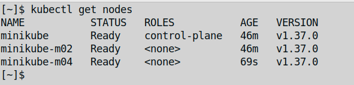
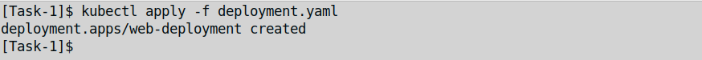
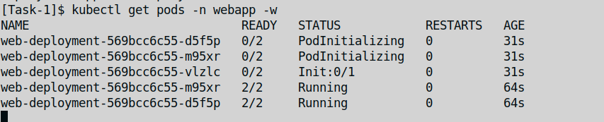
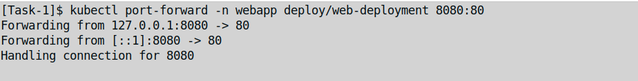
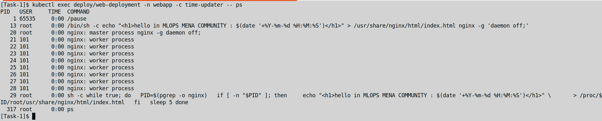
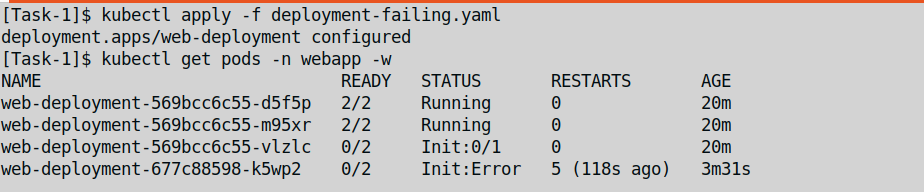
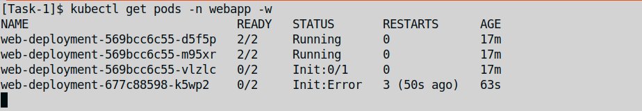

## 🚀 Steps

### 0. Cluster Setup Fail - How O fixed it

### 1. Cluster Setup

```bash
minikube start --nodes 3 --cni=calico --cpus 2 --memory 2200
kubectl get nodes
```



### 2. Create namespace

```bash
kubectl create namespace webapp
```


### 3: Deployment Manifest (deployment.yaml)

Save the following configuration as deployment.yaml. It configures `shareProcessNamespace: true`, the `init-done` init container, the main nginx container, and the `time-updater` sidecar with `SYS_PTRACE` capability (without using any volumes).

```yaml
apiVersion: apps/v1
kind: Deployment
metadata:
  name: web-deployment
  namespace: webapp
spec:
  replicas: 3
  selector:
    matchLabels:
      app: web
  template:
    metadata:
      labels:
        app: web
    spec:
      shareProcessNamespace: true
      initContainers:
        - name: init-done
          image: busybox:1.36
          command: ["sh", "-c", "echo done"]
      containers:
        - name: nginx
          image: nginx:1.27
          ports:
            - containerPort: 80
          command:
            - /bin/sh
            - -c
            - |
              echo "<h1>hello in MLOPS MENA COMMUNITY : $(date '+%Y-%m-%d %H:%M:%S')</h1>" > /usr/share/nginx/html/index.html
              nginx -g 'daemon off;'
        - name: time-updater
          image: busybox:1.36
          securityContext:
            capabilities:
              add:
                - SYS_PTRACE
          command:
            - sh
            - -c
            - |
              while true; do
                PID=$(pgrep -o nginx)
                if [ -n "$PID" ]; then
                  echo "<h1>hello in MLOPS MENA COMMUNITY : $(date '+%Y-%m-%d %H:%M:%S')</h1>" \
                    > /proc/$PID/root/usr/share/nginx/html/index.html
                fi
                sleep 5
              done
```

### 4: Deploy and Verify

Apply the manifest and test the live time updates:

```bash
kubectl apply -f deployment.yaml
kubectl get pods -n webapp -w # wait for 2/2 Running (Ctrl+C to stop)
```





Once all 3 Pods show 2/2 Running, run port-forwarding in a separate terminal and visit `http://localhost:8080`:

```bash
kubectl port-forward -n webapp deploy/web-deployment 8080:80 # keeps running: use a second terminal
```



• Open http://localhost:8080. Refresh after 5 seconds: the time changes.


• Sidecar-sees-nginx


### 5: Failing the Init Container

Duplicate `deployment.yaml` and rename it to `deployment-failing.yaml`
Update line 20 in `deployment-failing.yaml` to force an error:

```yaml
command: ["sh", "-c", "echo 'init failed'; exit 1"]
```

Apply the `deployment-failing.yaml` (don't delete the Deployment) and watch the new Pod:

```bash
kubectl apply -f deployment-failing.yaml
```




Watch the new Pod:

```bash
kubectl apply -f deployment-failing.yaml
kubectl get pods -n webapp -w
kubectl logs <new-pod> -n webapp -c init-done
kubectl describe pod <new-pod> -n webapp
kubectl rollout status deploy/web-deployment -n webapp   # waits (up to 10 min): Ctrl+C to stop
```

. Here are the answers to the questions in Step 5:
• Which status does the new Pod show?
The new Pod initially enters `Init:Error` and quickly transitions into `Init:CrashLoopBackOff (0/2 Ready)`` as Kubernetes repeatedly tries and fails to run the init container.

• Do Nginx and time-updater start?
No. Init containers must run to completion and exit with code `0` before Kubernetes starts any of the main application or sidecar containers.

• Is the page still reachable, and why?
Yes. By default, Kubernetes Deployments use a `RollingUpdate` strategy (`maxUnavailable: 25%` / `maxSurge: 25%`). Because the new Pod never becomes `Ready`, Kubernetes halts the rollout and keeps all 3 old Pods `(2/2 Running)` alive to serve traffic without downtime.

### 6: Fix & Rollback

To restore the Deployment to a healthy state, run `kubectl apply -f deployment.yaml`, or roll back directly using kubectl:

```bash
kubectl rollout undo deploy/web-deployment -n webapp
kubectl rollout status deploy/web-deployment -n webapp
```
