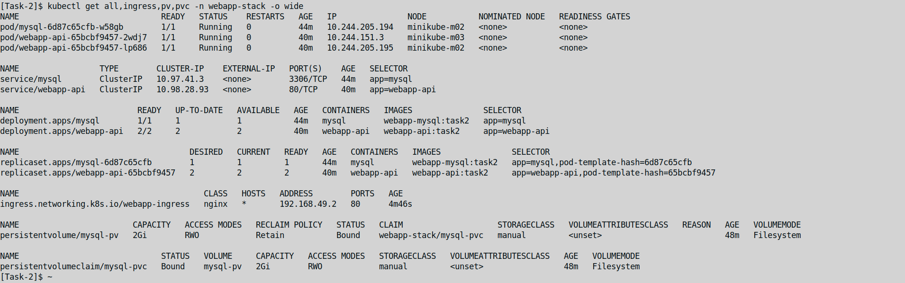
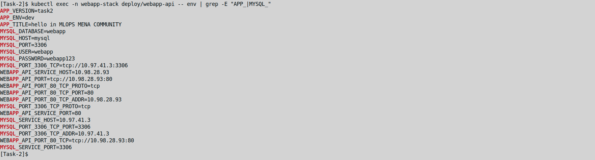
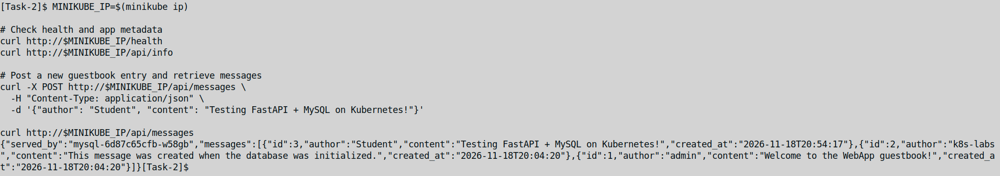
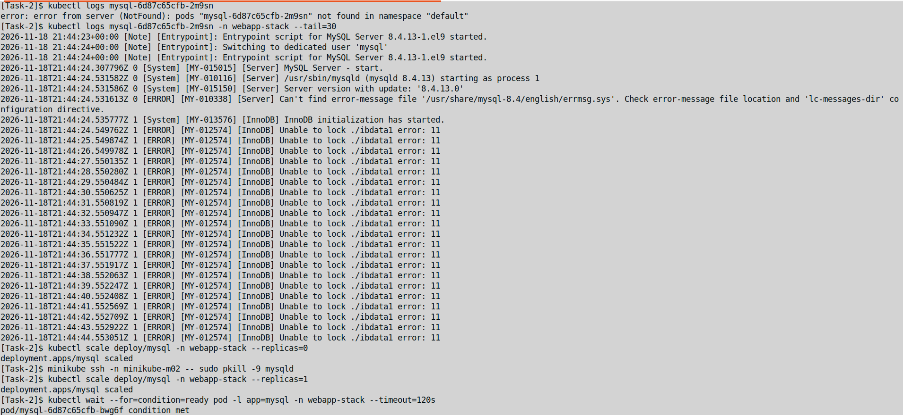
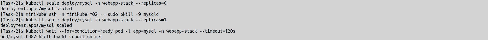
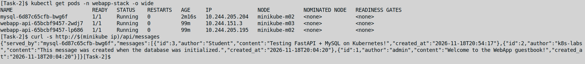

# Task Session 2: FastAPI + MySQL with ConfigMap, Secret & Ingress

## Overview

In this task, a **FastAPI** guestbook application connected to a **MySQL 8.4** database was deployed on a 3-node Minikube cluster. The architecture implements:

- **Persistent Storage:** A `PersistentVolume` (`hostPath` pinned to `minikube-m02` via `nodeAffinity`) and `PersistentVolumeClaim` to persist MySQL data across Pod restarts.
- **Configuration & Secrets:** Application settings stored in a `ConfigMap` and database credentials stored securely in a `Secret`.
- **Service Discovery & Ingress:** Internal `ClusterIP` Services for `mysql` and `webapp-api`, exposed externally via an NGINX `Ingress`.

---

## Architecture

```text
Browser ──▶ Ingress Controller ──▶ Ingress (webapp-ingress) ──▶ Service (webapp-api:80) ──▶ 2x FastAPI Pods (:8000)
                                                                                                   │
                                                                                                   ▼
                                                                           MySQL Pod (:3306) ◀── Service (mysql:3306)
                                                                                 │
                                                                                 ▼
                                                                      PVC (mysql-pvc) ──▶ PV (mysql-pv on minikube-m02)
```

---

## Project Structure

```text
Task-2/
├── 01-namespace.yaml
├── 02-secret.yaml
├── 03-configmap.yaml
├── 04-storage.yaml
├── 05-mysql.yaml
├── 06-webapp.yaml
├── 07-ingress.yaml
├── images/               # Screenshots for verification
└── README.md
```

---

## Implementation Steps

### 1. Build & Load Docker Images into Minikube

Built both custom Docker images (`webapp-api:task2` and `webapp-mysql:task2`) locally and loaded them into the Minikube cluster:

```bash
chmod -x mysql/initdb/01-setup.sh
docker build -t webapp-api:task2 ./webapp
docker build -t webapp-mysql:task2 ./mysql

minikube image load webapp-api:task2
minikube image load webapp-mysql:task2
minikube image ls | grep task2
```

## 

### 2. Create the Namespace (`01-namespace.yaml`)

Created the isolated `webapp-stack` namespace for all task resources (except the cluster-scoped `PersistentVolume`):

```bash
kubectl apply -f 01-namespace.yaml
```

## .png>)

### 3. Create the Secret (`02-secret.yaml`)

Created `mysql-secret` using `stringData` to store the MySQL root password and application database credentials:

```bash
kubectl apply -f 02-secret.yaml
```

## .png>)

### 4. Create the ConfigMap (`03-configmap.yaml`)

Created `webapp-config` containing non-sensitive environment variables (`APP_TITLE`, `APP_ENV`, `MYSQL_HOST`, `MYSQL_PORT`, and `MYSQL_DATABASE`):

```bash
kubectl apply -f 03-configmap.yaml
```

## .png>)

### 5. Create Persistent Storage (`04-storage.yaml`)

Created `mysql-pv` (`2Gi`, `storageClassName: manual`, `hostPath: /data/webapp-mysql`) pinned to worker node `minikube-m02` using `nodeAffinity`, and bound it to `mysql-pvc`:

```bash
kubectl apply -f 04-storage.yaml
kubectl get pv,pvc -n webapp-stack
```

## .png>)

### 6. Deploy MySQL (`05-mysql.yaml`)

Deployed a single-replica MySQL server using the `Recreate` deployment strategy, mounting `mysql-pvc` at `/var/lib/mysql`, and exposing it internally via a `ClusterIP` Service on port `3306`:

```bash
kubectl apply -f 05-mysql.yaml
kubectl logs deploy/mysql -n webapp-stack
kubectl get endpoints mysql -n webapp-stack
```

## .png>)

### 7. Deploy FastAPI Application (`06-webapp.yaml`)

Deployed 2 replicas of `webapp-api:task2` injecting configuration via `envFrom` (`webapp-config`) and credentials via `secretKeyRef` (`mysql-secret`), exposed via Service `webapp-api` (`80 -> 8000`):

```bash
kubectl apply -f 06-webapp.yaml
kubectl get endpoints webapp-api -n webapp-stack # check: 2 IPs on port 8000
kubectl exec -n webapp-stack deploy/webapp-api -- env | grep -E "APP_|MYSQL_"   # check the variables
```

.png>)

.png>)

### 8. Enable Ingress Controller & Create Ingress (`07-ingress.yaml`)

Enabled the Minikube NGINX Ingress addon and applied `webapp-ingress` to route HTTP traffic to `webapp-api`:

```bash
# Choose one option.
# Option A: minikube addon
minikube addons enable ingress

# Option B: Helm
helm upgrade --install ingress-nginx ingress-nginx \
  --repo https://kubernetes.github.io/ingress-nginx \
  --namespace ingress-nginx --create-namespace

kubectl get pods -n ingress-nginx # check: controller is Running

kubectl apply -f 07-ingress.yaml

kubectl get ingress -n webapp-stack # check: nginx
kubectl port-forward -n ingress-nginx svc/ingress-nginx-controller 8080:80 # keeps running: use a second terminal

```

Open http://localhost:8080.
Other ways to reach the Ingress: http://$(minikube ip) (Linux), or minikube tunnel then http://127.0.0.1 (Windows/macOS with Docker).

.png>)

.png>)

## Verification & Screenshots

### 1. Pods, Services, Endpoints & Ingress Status

```bash
kubectl get all,ingress,pv,pvc -n webapp-stack -o wide
```



### 2. Environment Variables Inside `webapp-api` Pod

```bash
kubectl exec -n webapp-stack deploy/webapp-api -- env | grep -E "APP_|MYSQL_"
```



### 3. Guestbook API Testing (GET & POST via Ingress)

```bash
MINIKUBE_IP=$(minikube ip)

# Check health and app metadata
curl http://$MINIKUBE_IP/health
curl http://$MINIKUBE_IP/api/info

# Post a new guestbook entry and retrieve messages
curl -X POST http://$MINIKUBE_IP/api/messages \
  -H "Content-Type: application/json" \
  -d '{"author": "Student", "content": "Testing FastAPI + MySQL on Kubernetes!"}'

curl http://$MINIKUBE_IP/api/messages
```



### 4. Data Persistence Across Pod Restarts

Deleted the MySQL Pod to verify that the `Recreate` strategy schedules the new Pod on `minikube-m02` and retains previously saved guestbook messages:

```bash
kubectl delete pod -l app=mysql -n webapp-stack

kubectl wait --for=condition=ready pod -l app=mysql -n webapp-stack --timeout=120s
```


The timeout happened because `mysql-6d87c65cfb-2m9sn` took longer than 120 seconds to become ready or hit an error during startup.

### Check Why the Pod Timed Out:

Run these two commands to see the current status and logs of mysql-6d87c65cfb-2m9sn:

```bash
kubectl get pods -n webapp-stack
kubectl logs mysql-6d87c65cfb-2m9sn -n webapp-stack --tail=30
```


That log confirms the exact problem:
`[ERROR] [MY-012574] [InnoDB] Unable to lock ./ibdata1 error: 11`
Even though Kubernetes marked the old Pod as deleted, the underlying mysqld process inside `minikube-m02` is still running or holding a file lock on `/data/webapp-mysql/ibdata1`.

### How to Release the Lock and Fix It Immediately

Run these commands to stop the Deployment, kill the lingering mysqld process inside minikube-m02, and start a single clean Pod:

```bash

# 1.Scale MySQL down to 0 so Kubernetes stops spawning new Pods
kubectl scale deploy/mysql -n webapp-stack --replicas=0

# 2.Kill any lingering mysqld process holding the file lock inside minikube-m02
minikube ssh -n minikube-m02 -- sudo pkill -9 mysqld

# 3. Scale MySQL back up to 1
kubectl scale deploy/mysql -n webapp-stack --replicas=1

# 4. Wait for the single Pod to become Ready
kubectl wait --for=condition=ready pod -l app=mysql -n webapp-stack --timeout=120s
```

• Because we only killed the stuck process without deleting `/data/webapp-mysql`, all your existing messages (`id: 1, 2, 3`) will still be intact.
• To test persistence cleanly later without triggering this lock issue again, always use `kubectl scale deploy/mysql -n webapp-stack --replicas=0` followed by `--replicas=1` instead of `kubectl delete pod`.



```bash
# Confirm 1/1 Running on minikube-m02
kubectl get pods -n webapp-stack -o wide

# Verify your saved messages are still in MySQL
curl http://$(minikube ip)/api/messages

```


